# Smart Courier Planner

A Python prototype of an intelligent courier planning system. Given a list of parcels and a city road network, it

1. **prioritises** parcels by deadline and priority (merge sort),
2. **packs** the best set of parcels into the van for one trip (0/1 knapsack, dynamic programming),
3. finds **shortest road paths** between customers (Dijkstra),
4. builds the **delivery route** (nearest-neighbour TSP approximation, improved with 2-opt),
5. **times every step** and compares it against alternative algorithms on small to large datasets.

It uses only the Python standard library; matplotlib and Pillow are needed only for charts and screenshots.

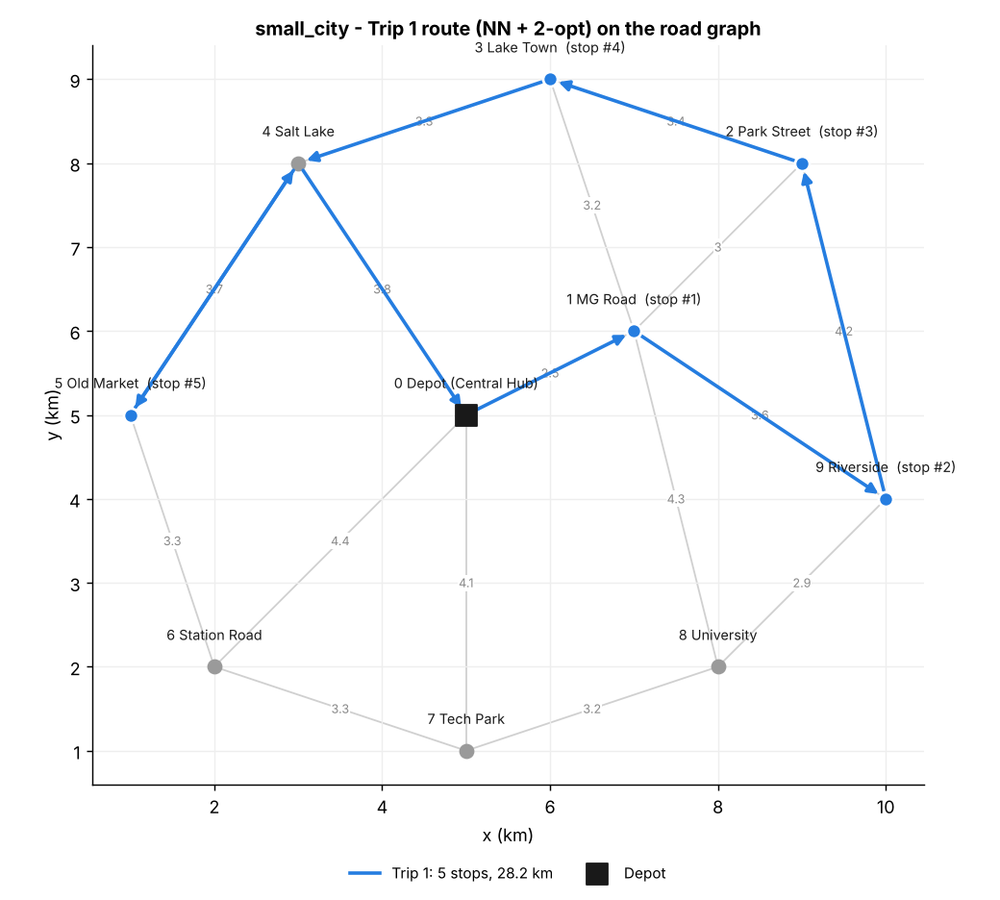

---

## Project structure

```text
smart-courier-planner/
├── main.py                    # CLI: run the planner on a dataset
├── benchmark.py               # Phase 4: runtime experiments -> results/*.csv + docs/charts/*.png
├── run_all.sh                 # one command that reproduces every result
├── requirements.txt
├── courier/                   # the algorithm package
│   ├── models.py              # Parcel, Location, Dataset (JSON load/save)
│   ├── sorting.py             # merge / quick / heap / insertion sort + prioritise()
│   ├── knapsack.py            # 0/1 knapsack DP (2-D table + traceback, 1-D), greedy, brute force
│   ├── graph.py               # RoadGraph (adjacency list), Dijkstra, path rebuild, Floyd-Warshall
│   ├── tsp.py                 # nearest neighbour, 2-opt, lateness repair, Held-Karp (exact)
│   ├── planner.py             # integration: sort -> knapsack -> Dijkstra -> TSP, per-step timing
│   └── report.py              # console output (tables, DP table, schedule)
├── data/
│   ├── small_city.json        # 10 nodes, 12 parcels (hand-made, checkable by hand)
│   ├── medium_city.json       # 40 nodes, 60 parcels
│   ├── large_city.json        # 200 nodes, 400 parcels
│   └── generate_data.py       # reproducible synthetic city generator
├── tests/test_courier.py      # 17 correctness tests
├── tools/                     # scripts that regenerate screenshots, maps and the design diagram
├── results/                   # benchmark CSVs + log
└── docs/
    ├── PHASE1_DESIGN.md       # Phase 1 design document
    ├── REPORT.md / REPORT.pdf # final report (all 5 phases)
    ├── charts/                # runtime charts, route maps, design diagram
    ├── screenshots/           # terminal screenshots of every demo run
    └── output_traces/         # full text output of every demo run
```

## Execution steps

```bash
# 1. get the code
git clone <your-repo-url> smart-courier-planner      # or unzip the submission
cd smart-courier-planner

# 2. (optional) virtual environment
python3 -m venv .venv && source .venv/bin/activate      # Windows: .venv\Scripts\activate

# 3. install chart libraries (the planner itself needs nothing)
pip install -r requirements.txt

# 4. run the planner
python main.py data/small_city.json --adjacency --dp-table     # full step-by-step trace
python main.py data/medium_city.json --all-trips               # plan trips until all parcels delivered
python main.py data/large_city.json                            # 200-node stress run
python main.py data/medium_city.json --deadline-aware          # Phase-4 optimisation
python main.py data/small_city.json --no-2opt                  # plain nearest-neighbour route
python main.py data/small_city.json --sort quick               # swap the sorting algorithm

# 5. correctness tests
python -m unittest discover -s tests -t . -v

# 6. performance tests + charts (about 10 s)
python benchmark.py            # add --quick for a smaller run

# 7. regenerate screenshots / route maps / traces
python tools/make_screenshots.py

# or everything at once:
bash run_all.sh
```

Requires Python 3.9+ (tested on 3.13).

### CLI options

| Option | Effect |
|---|---|
| `--all-trips` | repeat sort → pack → route on left-over parcels until all are delivered |
| `--dp-table` | print the knapsack DP table `dp[i][c]` |
| `--adjacency` | print the graph's adjacency list |
| `--no-2opt` | keep the plain nearest-neighbour tour |
| `--deadline-aware` | after 2-opt, run the lateness-repair search (fewer late parcels, more km) |
| `--banded` | experiment: visit stops strictly by deadline band (kept to show why it fails) |
| `--sort {merge,quick,heap,insertion}` | choose the sorting algorithm (default: merge) |

## Dataset format

```json
{
  "name": "small_city", "vehicle_capacity": 50, "depot": 0,
  "locations": [{"node_id": 0, "name": "Depot (Central Hub)", "x": 5.0, "y": 5.0}, ...],
  "edges":     [[0, 1, 2.5], [0, 4, 3.8], ...],
  "parcels":   [{"parcel_id": "P001", "destination": 2, "weight": 10,
                 "priority": 5, "deadline": 2, "value": 0}, ...]
}
```

`weight` is in kg, `priority` runs from 1 to 5 (5 = critical), and `deadline` is in hours from the start of the shift. Leave `value` at 0 to use the computed score `10·priority + urgency bonus`.

## Key results

| What | Result |
|---|---|
| small_city trip 1 | 6 parcels, **50/50 kg**, DP value **343** (brute force agrees); route **35.9 km → 28.2 km** after 2-opt (−21.4 %); 0 late |
| medium_city, all trips | 4 trips, 60/60 parcels delivered, 385.6 km |
| large_city, all trips | 10 trips, 400/400 parcels, 1741 km; trip 1 plans 91 stops in about 30–45 ms |
| NN vs exact optimum (Held-Karp, 5–11 stops) | NN +1.6 % to +9.4 % on average; **NN + 2-opt within 0.74 %** |
| Sorting 20 000 parcels | merge 47 ms · quick 70 ms · heap 76 ms (insertion: 86 ms already at 2 000) |
| Shortest paths, 300 nodes | Dijkstra from trip stops 12 ms vs every node 62 ms vs Floyd-Warshall 185 ms |
| Largest pipeline (1 600 parcels, 800 nodes) | about 0.4 s; knapsack DP and Dijkstra take ~87 % of the time |

The full analysis is in [`docs/REPORT.md`](docs/REPORT.md) (PDF: `docs/REPORT.pdf`).

## Screenshots

| | |
|---|---|
| 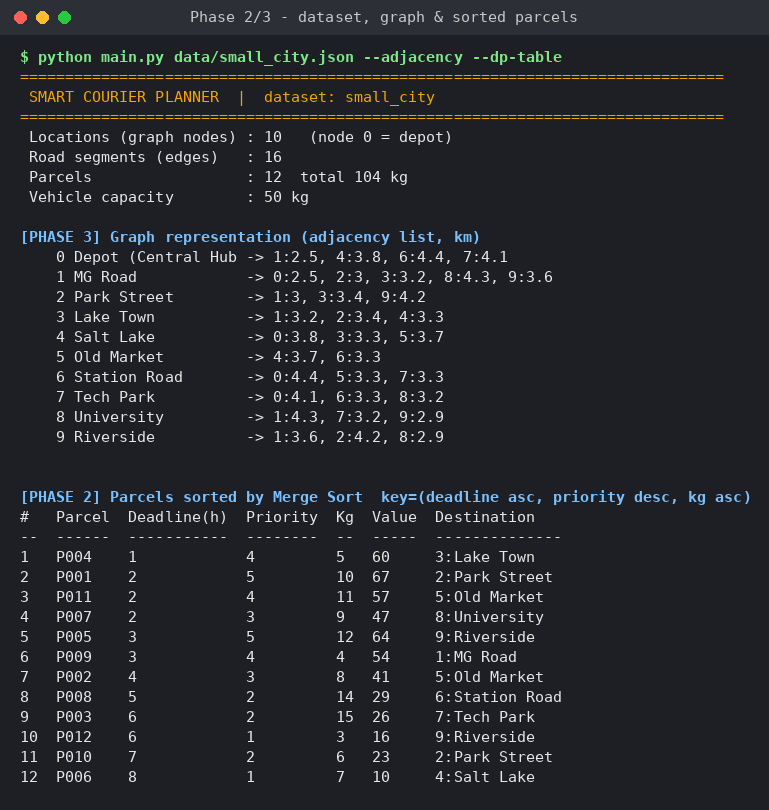 | 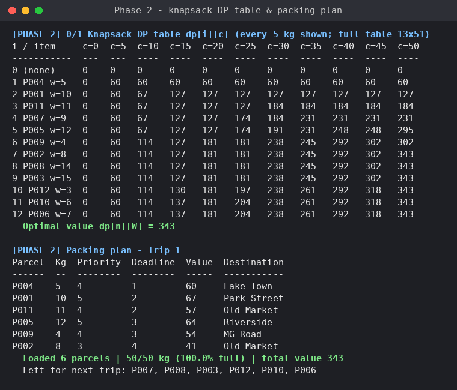 |
| 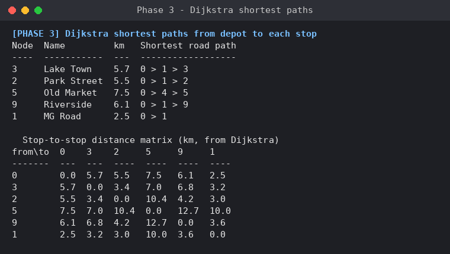 | 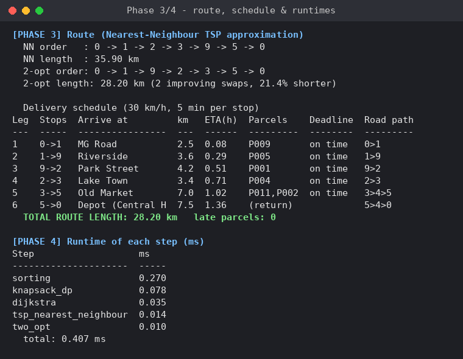 |
| 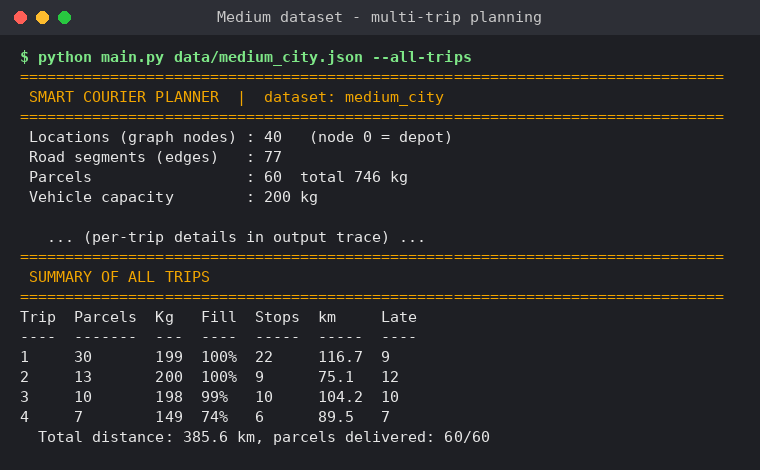 | 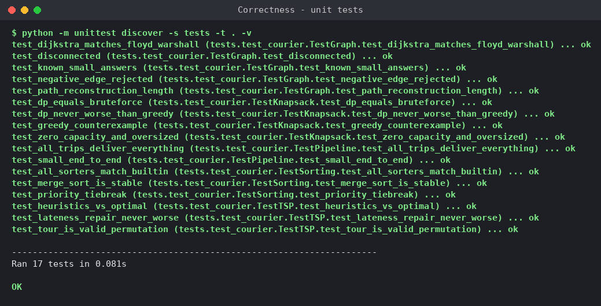 |

## Runtime charts

| | |
|---|---|
| 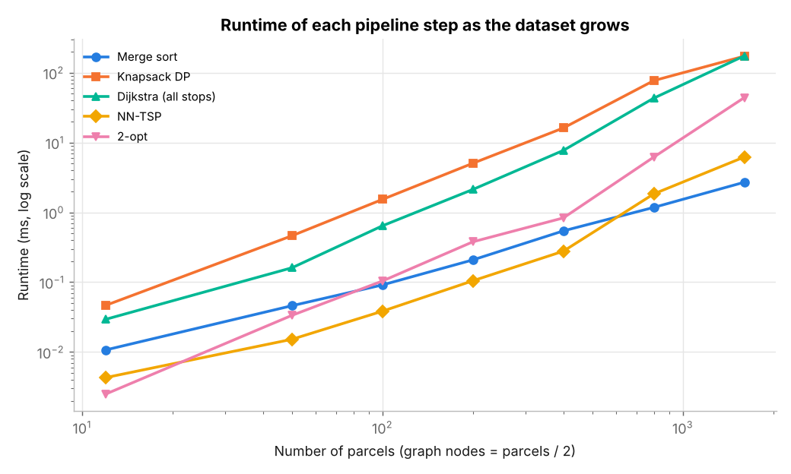 | 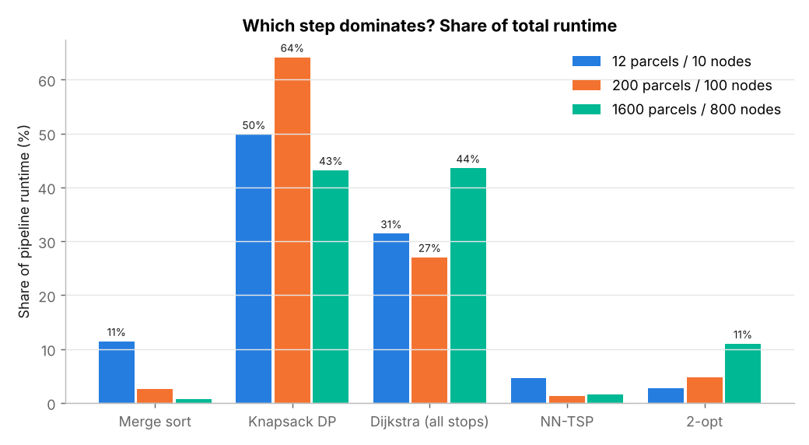 |
| 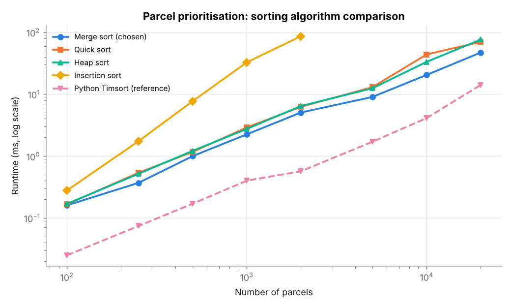 | 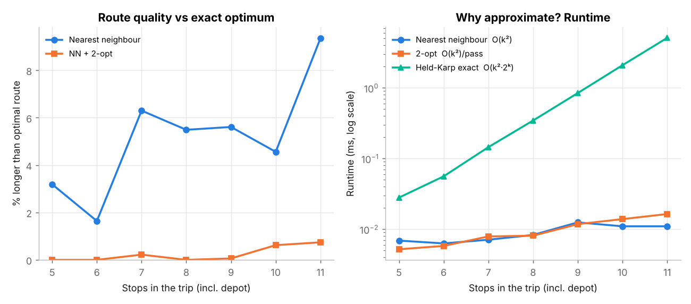 |
| 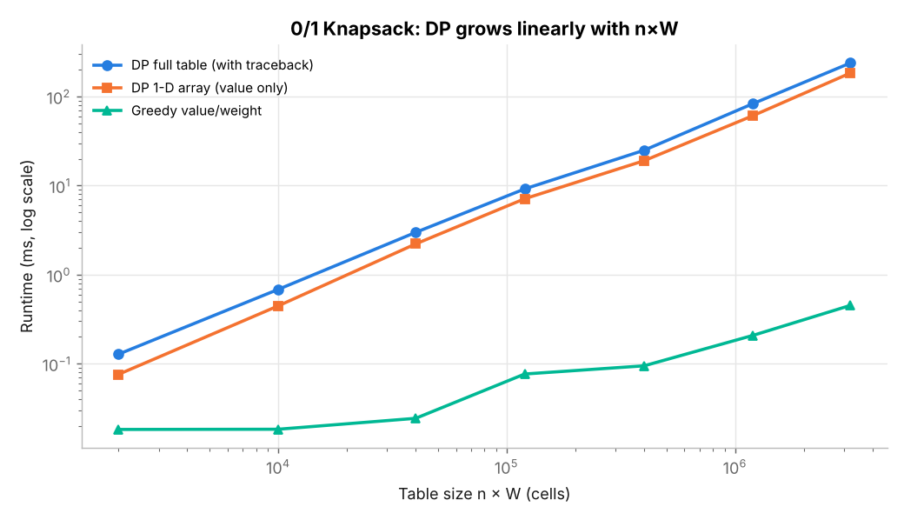 | 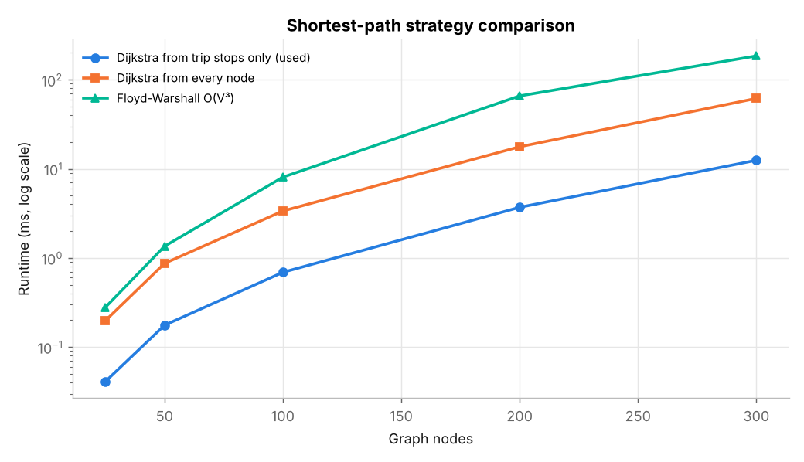 |
| 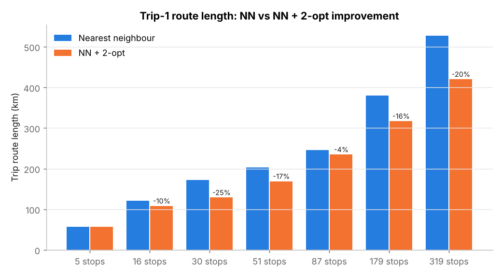 | 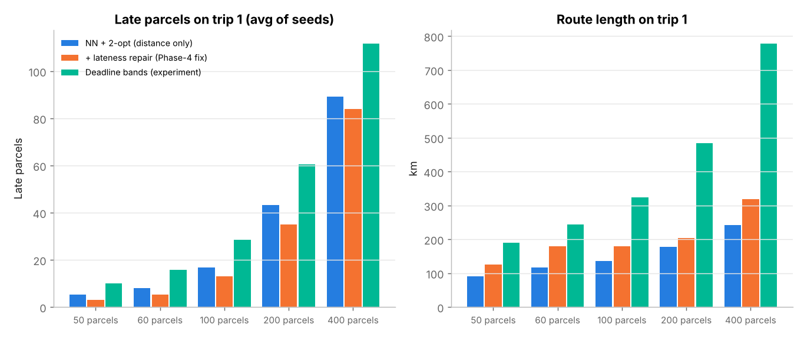 |
# col_algo_capstone
