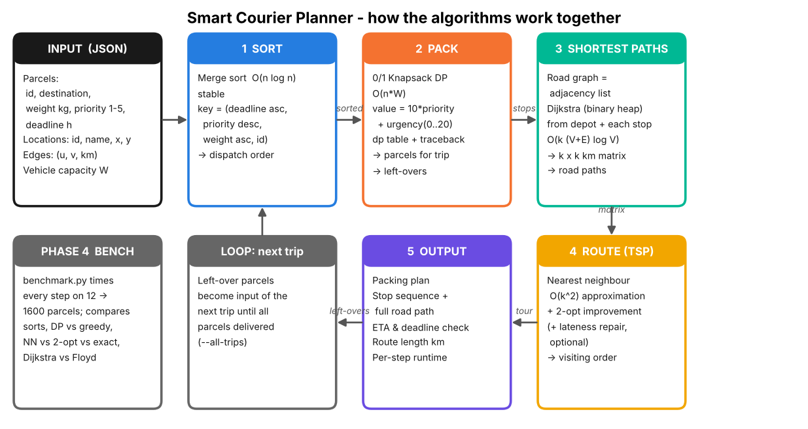

# Phase 1 – Courier Problem Design and Planning

## 1. Problem statement

A courier company has one van at a central depot, a list of parcels for the day and a city road network.
For every trip the planner must answer two questions:

1. **What goes in the van?** The van has a weight limit, so not every parcel fits. Urgent, high-priority parcels should go first.
2. **In what order are the customers visited?** The van leaves the depot, visits every customer whose parcel is loaded, and comes back, covering as few kilometres as possible.

Parcels that don't fit wait for the next trip. The planner repeats until every parcel is delivered.

| Sub-problem | Nature | Technique chosen | Lab topic reused |
|---|---|---|---|
| Put parcels in dispatch order | ordering | **Merge sort** (stable, O(n log n)) | Sorting |
| Choose parcels for one trip under a weight limit | 0/1 optimisation (NP-hard in general, pseudo-polynomial here) | **0/1 knapsack, dynamic programming** | Dynamic programming |
| Real road distance between two customers | single-source shortest path, non-negative weights | **Dijkstra with binary heap** | Graph algorithms |
| Order of visits | Travelling Salesman Problem (NP-hard) | **Nearest-neighbour heuristic + 2-opt** | Approximation algorithms |

## 2. Data design

### 2.1 Parcel attributes

| Field | Type | Meaning | Used by |
|---|---|---|---|
| `parcel_id` | str | unique id, e.g. `P007` | final tie-break, output |
| `destination` | int | graph node of the customer | Dijkstra / TSP |
| `weight` | int (kg) | integer so knapsack columns are integers | knapsack weight |
| `priority` | int 1–5 | 5 = critical (medicine, legal docs), 1 = low | sort key, knapsack value |
| `deadline` | int (hours from shift start) | latest acceptable delivery time | sort key, value, ETA check |
| `value` | int (optional) | override for the knapsack value; 0 = compute | knapsack |

**Knapsack value (delivery score).** `value = 10 × priority + round(20 × urgency)`, where
`urgency = (max_deadline − deadline) / (max_deadline − 1)` ∈ [0, 1].
Priority dominates (each level is worth 10 points), and an earlier deadline adds up to 20 points. This keeps the value an integer, so the DP stays exact.

### 2.2 Delivery points and graph format

* **Locations**: `node_id, name, x, y` (x, y in km, used only for drawing maps). Node 0 is always the **depot**.
* **Edges**: undirected road segments `[u, v, km]`, all weights ≥ 0 (Dijkstra's precondition, checked at load time).
* **In memory**: an **adjacency list** `adj[u] = [(v, km), …]`. Road networks are sparse (E ≈ 2–4 V), so an adjacency list takes O(V + E) memory where a matrix would take O(V²). It also lets Dijkstra run in O((V + E) log V).
* **Dataset file (JSON)**: `{name, vehicle_capacity, depot, locations[], edges[], parcels[]}`. See `data/small_city.json`.

### 2.3 Sample datasets

| Dataset | Nodes | Edges | Parcels | Total kg | Capacity | Purpose |
|---|---|---|---|---|---|---|
| `small_city.json` | 10 | 16 | 12 | 104 | 50 | hand-made; small enough to check by hand |
| `medium_city.json` | 40 | 77 | 60 | 746 | 200 | multi-trip demo |
| `large_city.json` | 200 | 369 | 400 | 5403 | 600 | stress test |
| benchmark (generated) | 10 → 800 | → 1486 | 12 → 1600 | – | 50 → 1500 | Phase 4 scaling |

Generated cities are random points in a 20 × 20 km square. Each node links to its 3 nearest neighbours, and a spanning tree is added so the graph is always connected. Edge length = straight-line distance × road factor (1.00–1.35). Seeds are fixed, so every run is reproducible.

## 3. Route-planning logic (how the pieces work together)



```text
load dataset ─► build adjacency list (once)
repeat until no parcels remain:
    1. SORT      parcels by (deadline ↑, priority ↓, weight ↑, id)        merge sort
    2. PACK      0/1 knapsack DP over the sorted list, capacity W         dp[i][c] + traceback
    3. STOPS     depot + distinct destinations of packed parcels
    4. DISTANCES Dijkstra from each stop  →  k × k matrix + parent arrays
    5. ROUTE     nearest-neighbour tour on the matrix, then 2-opt
                 (optional: lateness-repair relocation search)
    6. EXPAND    every leg → real road path via Dijkstra parents; ETA at 30 km/h + 5 min/stop
    7. REPORT    packing plan, route, km, late parcels, runtime per step
    remaining ← parcels left out by the knapsack
```


**Why this order?**

* Sorting comes first, so the knapsack sees parcels in dispatch order. Its traceback and the packing list are then readable in urgency order, and equal-value ties resolve toward the more urgent parcel.
* The knapsack runs *before* routing because the stops are only known once the load is fixed.
* Dijkstra runs only from the k stops of this trip, not from all V nodes. That is k/V of the cost of an all-pairs computation (measured in Phase 4).
* The TSP heuristic works on the Dijkstra matrix (a *metric*, so it satisfies the triangle inequality). The final route is then expanded back to real roads using the Dijkstra parent pointers.

## 4. Suitability of the selected techniques

| Choice | Alternatives considered | Why chosen |
|---|---|---|
| Merge sort | quick, heap, insertion | Guaranteed O(n log n) with no O(n²) worst case, and **stable**, so equal-key parcels keep manifest order. Fastest of the four hand-written sorts in Phase 4. |
| 0/1 knapsack DP | greedy by value/weight, brute force 2ⁿ | Parcels can't be split, so fractional greedy is wrong. DP is **exact** in O(n·W), which is small for kg capacities. Brute force is used only to verify it. |
| Dijkstra (heap) | Bellman-Ford O(VE), Floyd-Warshall O(V³), BFS | Road lengths are non-negative and the graph is sparse. Only k sources are needed. |
| Nearest neighbour | exact Held-Karp O(k²2ᵏ), brute force O(k!) | TSP is NP-hard. NN is O(k²), simple, and needs no tuning. Held-Karp is used only to measure the approximation ratio. |
| 2-opt | Or-opt, Christofides, LKH | Easy to implement and removes crossing legs. Measured within 0.8 % of optimal on average. |

## 5. Assumptions

* One van, one depot, constant average speed 30 km/h, 5 minutes of service per stop, 15 minutes to reload between trips.
* Parcels at the same destination are delivered in one stop.
* Weights are whole kilograms; a parcel heavier than the van's capacity is rejected.
* Roads are two-way (undirected graph).
