# 1. Summary

This project is a working Python prototype of a courier planning system. It reads a dataset of parcels, delivery points and roads, and for each van trip it produces

* a **dispatch order** of parcels (merge sort on deadline, priority, weight and id),
* an **optimal packing plan** for the van (0/1 knapsack, dynamic programming),
* **shortest road paths** between all stops of the trip (Dijkstra with a binary heap),
* an **ordered delivery route** and its length (nearest-neighbour TSP approximation, improved by 2-opt), with ETAs and a deadline check,
* the **runtime** of every step.

It is tested by 17 unit tests: each algorithm is checked against an independent reference (Python `sorted`, brute-force knapsack, Floyd-Warshall, exact Held-Karp TSP). It was benchmarked on datasets from 12 to 1 600 parcels.

| Phase | Deliverable | Where |
|---|---|---|
| 1 Design | problem, data model, graph format, algorithm choice, pipeline diagram | §2, `docs/PHASE1_DESIGN.md` |
| 2 Prioritisation & box filling | merge sort, DP table, selected parcels, packing plan | §3, screenshots 01–02 |
| 3 Route maker | adjacency list, Dijkstra paths, NN route, 2-opt, route length | §4, screenshots 03–04, route maps |
| 4 Performance | 6 experiments, 9 charts, CSVs, optimisation | §5, `results/`, `docs/charts/` |
| 5 Report & demo | this report, README, traces, screenshots | §6–§8 |

# 2. Phase 1 — Problem design

The full design document is `docs/PHASE1_DESIGN.md`; this section summarises it.

**Problem.** One van with a capacity of *W* kg starts at the depot (node 0). Each parcel *i* has a destination node, a weight *wᵢ* (kg), a priority (1–5) and a deadline (hours). For each trip, choose the parcels that maximise delivery value within *W*, then find the shortest closed route that visits all their destinations. Parcels left behind go on the next trip.

**Delivery value.** `vᵢ = 10·priorityᵢ + round(20·(D_max − deadlineᵢ)/(D_max − 1))`. Priority dominates, an earlier deadline adds up to 20 points, and the value stays an integer.

**Graph format.** The road network is an undirected weighted graph stored as an adjacency list `adj[u] = [(v, km)]`. Datasets are JSON files with `locations`, `edges [u, v, km]`, `parcels` and `vehicle_capacity`.

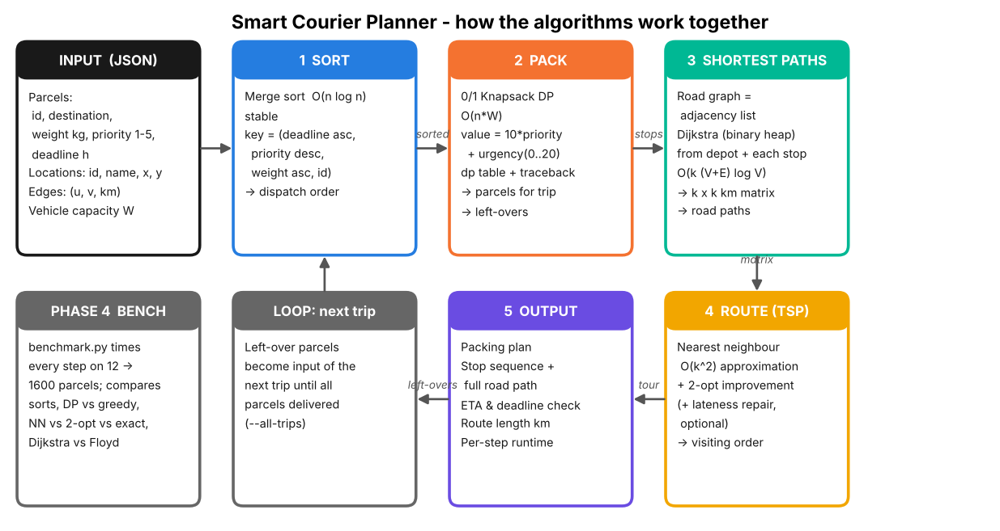{width=100%}

| Step | Algorithm | Complexity | Why |
|---|---|---|---|
| Sort | merge sort | O(n log n), stable | guaranteed bound; equal-key parcels keep manifest order |
| Pack | 0/1 knapsack DP | O(n·W) time, O(n·W) space | parcels are indivisible; DP is exact |
| Distances | Dijkstra (heap), from each of the *k* stops | O(k·(V+E) log V) | non-negative sparse road graph |
| Route | nearest neighbour + 2-opt | O(k²) + O(k²) per pass | TSP is NP-hard; exact is O(k²2ᵏ) |

# 3. Phase 2 — Package prioritisation and box filling

## 3.1 Sorting

**Sort key:** `(deadline ↑, priority ↓, weight ↑, parcel_id ↑)`. This is earliest-deadline-first: ties go to the more important parcel, then the lighter one (easier to fit). The id makes the order fully deterministic.

Four sorts were written from scratch (`courier/sorting.py`). All four agree with Python's `sorted` on random inputs of 0–513 parcels (test `test_all_sorters_match_builtin`), and merge sort's stability is checked separately. **Merge sort was chosen** because it is the only one that is both O(n log n) in the worst case and stable, and it was also the fastest of the four (§5.2).

Sorted dispatch order for `small_city` (screenshot 01):

| # | Parcel | Deadline | Priority | kg | Value | Destination |
|---|---|---|---|---|---|---|
| 1 | P004 | 1 | 4 | 5 | 60 | Lake Town |
| 2 | P001 | 2 | 5 | 10 | 67 | Park Street |
| 3 | P011 | 2 | 4 | 11 | 57 | Old Market |
| 4 | P007 | 2 | 3 | 9 | 47 | University |
| 5 | P005 | 3 | 5 | 12 | 64 | Riverside |
| 6 | P009 | 3 | 4 | 4 | 54 | MG Road |
| 7 | P002 | 4 | 3 | 8 | 41 | Old Market |
| 8 | P008 | 5 | 2 | 14 | 29 | Station Road |
| 9 | P003 | 6 | 2 | 15 | 26 | Tech Park |
| 10 | P012 | 6 | 1 | 3 | 16 | Riverside |
| 11 | P010 | 7 | 2 | 6 | 23 | Park Street |
| 12 | P006 | 8 | 1 | 7 | 10 | Salt Lake |

## 3.2 0/1 knapsack (dynamic programming)

Recurrence, with `dp[0][c] = 0`:

```text
dp[i][c] = dp[i-1][c]                                    if wᵢ > c
dp[i][c] = max(dp[i-1][c], dp[i-1][c-wᵢ] + vᵢ)           otherwise
```

The answer is `dp[n][W]`. A **traceback** from `(n, W)` recovers the chosen parcels: parcel *i* was taken if `dp[i][c] ≠ dp[i-1][c]`. The full 13 × 51 table for `small_city` is printed with `--dp-table` (columns every 5 kg are shown in screenshot 02):

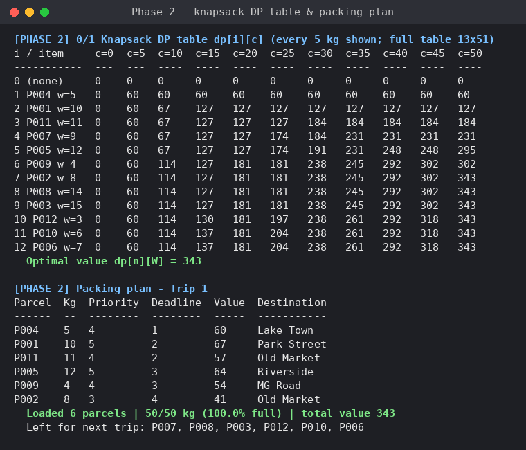{width=80%}

**Packing plan, trip 1 (capacity 50 kg):**

| Parcel | kg | Priority | Deadline | Value | Destination |
|---|---|---|---|---|---|
| P004 | 5 | 4 | 1 | 60 | Lake Town |
| P001 | 10 | 5 | 2 | 67 | Park Street |
| P011 | 11 | 4 | 2 | 57 | Old Market |
| P005 | 12 | 5 | 3 | 64 | Riverside |
| P009 | 4 | 4 | 3 | 54 | MG Road |
| P002 | 8 | 3 | 4 | 41 | Old Market |
| **Total** | **50 / 50** | | | **343** | 5 distinct stops |

Left for the next trip: P007, P008, P003, P012, P010, P006.

**Correctness evidence.**

* Brute force over all 2¹² = 4 096 subsets also gives **343**. The unit test repeats this check on 40 random instances, and the space-optimised 1-D DP agrees too.
* Hand check: P007 (9 kg, value 47) is the most urgent parcel left out. The van is full, so adding it means unloading at least 9 kg. The cheapest way to free 9 kg is to drop P011 (11 kg, value 57), and 57 > 47, so leaving P007 out is correct.
* The greedy value/weight heuristic loads P004, P001, P007, P005, P009, P012 and P010, for a value of only **331** (−3.5 %). This shows why DP is needed. A textbook counter-example (values 60/100/120, weights 10/20/30, W = 50: DP gives 220, greedy 160) is also in the tests.

# 4. Phase 3 — Route maker and graph processing

## 4.1 Graph representation

`RoadGraph` builds an adjacency list from the edge list. Negative weights are rejected, and connectivity is checked before planning. The adjacency list for `small_city` (screenshot 01):

```text
  0 Depot (Central Hub -> 1:2.5, 4:3.8, 6:4.4, 7:4.1
  1 MG Road            -> 0:2.5, 2:3, 3:3.2, 8:4.3, 9:3.6
  2 Park Street        -> 1:3, 3:3.4, 9:4.2
  3 Lake Town          -> 1:3.2, 2:3.4, 4:3.3
  4 Salt Lake          -> 0:3.8, 3:3.3, 5:3.7
  5 Old Market         -> 4:3.7, 6:3.3
  ...
```

## 4.2 Dijkstra shortest paths

Dijkstra uses `heapq` with lazy deletion and records a `parent` array for path reconstruction. It is run from the depot and from each stop of the trip to build a k × k distance matrix.

| Stop | km from depot | Shortest road path |
|---|---|---|
| 3 Lake Town | 5.7 | 0 → 1 → 3 |
| 2 Park Street | 5.5 | 0 → 1 → 2 |
| 5 Old Market | 7.5 | 0 → 4 → 5 (beats 0 → 6 → 5 = 7.7) |
| 9 Riverside | 6.1 | 0 → 1 → 9 |
| 1 MG Road | 2.5 | 0 → 1 |

Correctness: Dijkstra is compared with Floyd-Warshall from every 5th source on three random 35-node cities, and every reconstructed path's edge sum is checked against its reported distance.

## 4.3 Nearest-neighbour route and 2-opt

**Nearest neighbour** (on the Dijkstra matrix): 0 →(2.5) 1 →(3.0) 2 →(3.4) 3 →(6.8) 9 →(12.7) 5 →(7.5) 0 = **35.9 km**. The greedy rule leaves Old Market, the far-west stop, to the end, which forces a 12.7 km leg.

**2-opt** reverses segments while that shortens the tour. Two improving swaps give
0 → 1 → 9 → 2 → 3 → 5 → 0 = 2.5 + 3.6 + 4.2 + 3.4 + 7.0 + 7.5 = **28.2 km** (−21.4 %). The exact Held-Karp solver confirms that **28.2 km is optimal** for this trip.

Each leg is then expanded into real roads with the Dijkstra parents. For example, Lake Town → Old Market is 3 → 4 → 5 (7.0 km).

| Leg | Arrive at | km | ETA (h) | Parcels | Deadline |
|---|---|---|---|---|---|
| 1 | MG Road | 2.5 | 0.08 | P009 | on time |
| 2 | Riverside | 3.6 | 0.29 | P005 | on time |
| 3 | Park Street | 4.2 | 0.51 | P001 | on time |
| 4 | Lake Town | 3.4 | 0.71 | P004 | on time |
| 5 | Old Market | 7.0 | 1.02 | P011, P002 | on time |
| 6 | Depot | 7.5 | 1.36 | — | — |

**Total route length: 28.2 km, 0 late parcels.**

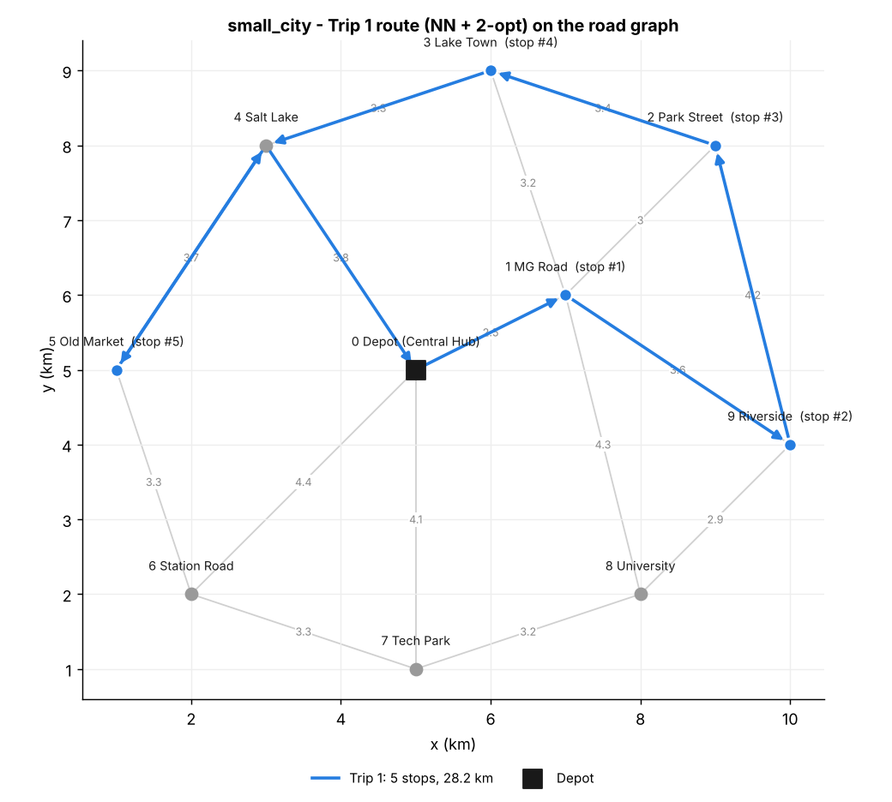{width=72%}

**Multi-trip run (`medium_city --all-trips`):**

| Trip | Parcels | kg | Fill | Stops | km |
|---|---|---|---|---|---|
| 1 | 30 | 199 | 100 % | 22 | 116.7 |
| 2 | 13 | 200 | 100 % | 9 | 75.1 |
| 3 | 10 | 198 | 99 % | 10 | 104.2 |
| 4 | 7 | 149 | 74 % | 6 | 89.5 |
| | **60/60** | | | | **385.6** |

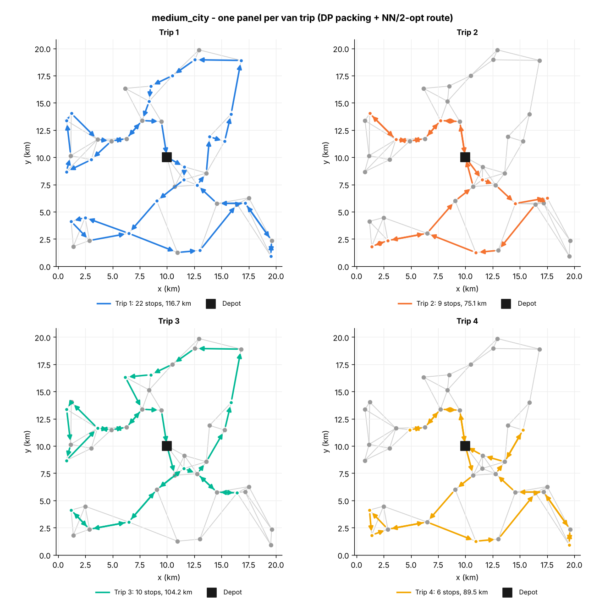{width=85%}

The DP keeps the van 99–100 % full on every trip except the last, which carries whatever is left.

# 5. Phase 4 — Performance testing and optimisation

`benchmark.py` runs six experiments on reproducible generated cities. Each timing is the median of 3–5 runs with `time.perf_counter` (Python 3.13, single core). Raw numbers are in `results/*.csv`.

## 5.1 Whole pipeline, small → large

| Parcels | Nodes | Stops | Sort | Knapsack DP | Dijkstra | NN | 2-opt | **Total** |
|---|---|---|---|---|---|---|---|---|
| 12 | 10 | 5 | 0.011 | 0.047 | 0.029 | 0.004 | 0.003 | **0.09 ms** |
| 50 | 25 | 16 | 0.046 | 0.46 | 0.16 | 0.015 | 0.034 | **0.72 ms** |
| 100 | 50 | 30 | 0.091 | 1.53 | 0.64 | 0.038 | 0.10 | **2.4 ms** |
| 200 | 100 | 51 | 0.21 | 5.05 | 2.13 | 0.10 | 0.38 | **7.9 ms** |
| 400 | 200 | 87 | 0.54 | 16.1 | 7.7 | 0.28 | 0.83 | **25.5 ms** |
| 800 | 400 | 179 | 1.18 | 77.0 | 43.2 | 1.84 | 6.19 | **129 ms** |
| 1 600 | 800 | 319 | 2.70 | 172.4 | 173.9 | 6.19 | 43.9 | **399 ms** |

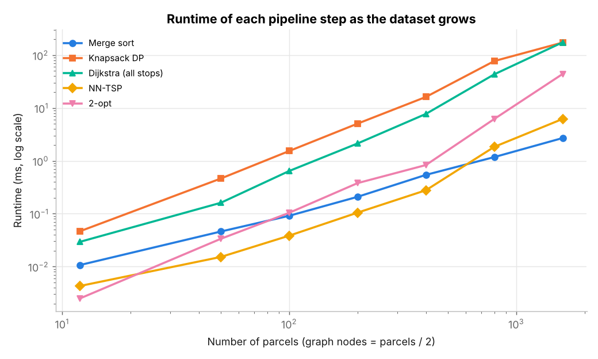{width=80%}

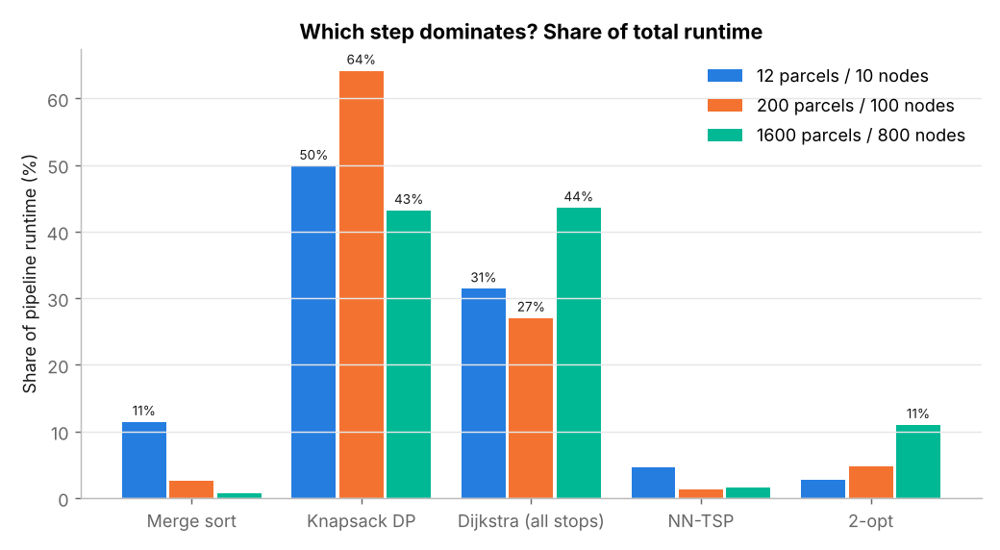{width=80%}

**What this shows.** Knapsack DP (O(n·W)) and Dijkstra (O(k·(V+E) log V)) together take 81–93 % of the runtime at every size. Sorting is negligible, under 1 % at 1 600 parcels. 2-opt grows fastest (super-quadratic in k) and reaches 11 % of the time at 319 stops. Even the largest case is planned in under half a second.

## 5.2 Sorting algorithms

| n | Merge | Quick | Heap | Insertion | Python Timsort (C) |
|---|---|---|---|---|---|
| 1 000 | 2.2 ms | 2.9 | 2.7 | 32.7 | 0.4 |
| 2 000 | 5.1 | 6.2 | 6.4 | 86.4 | 0.6 |
| 20 000 | **47.0** | 69.9 | 76.2 | — | 14.1 |

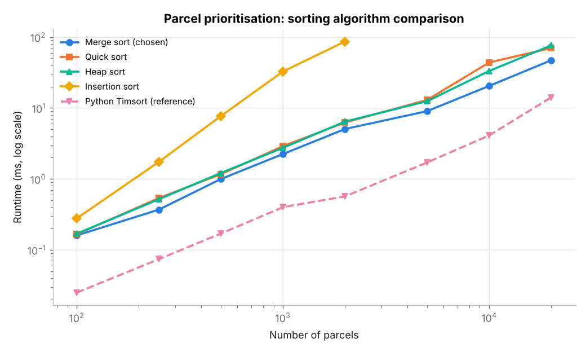{width=75%}

Merge sort is the fastest of the hand-written sorts. It computes each key only once, and its merge step is sequential. Insertion sort's O(n²) makes it unusable beyond a few hundred parcels. The built-in Timsort is about 3× faster than merge sort only because it is written in C.

## 5.3 Knapsack: DP vs greedy, 2-D vs 1-D

| n | W | n·W cells | DP 2-D | DP 1-D | Greedy | Greedy loses |
|---|---|---|---|---|---|---|
| 20 | 100 | 2 000 | 0.13 ms | 0.08 | 0.02 | 1.06 % |
| 200 | 600 | 120 000 | 9.2 | 7.1 | 0.08 | 0.59 % |
| 1 600 | 2 000 | 3.2 M | 238 | 183 | 0.45 | 0.00 % |

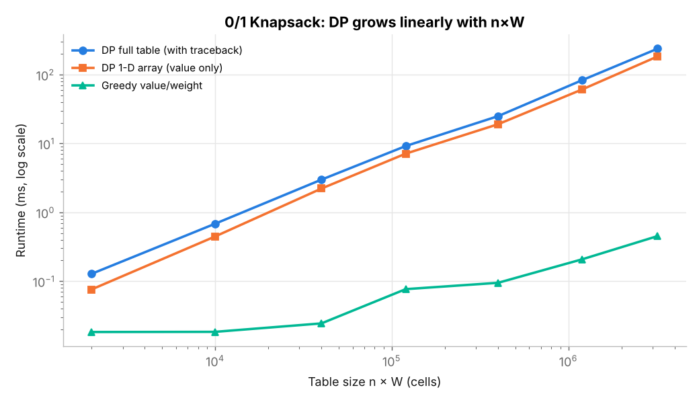{width=72%}

The runtime grows linearly with n·W, as predicted. The 1-D array saves about 25 % of the time and uses O(W) memory instead of O(n·W), but it can't produce a traceback. Greedy is up to about 500× faster but sub-optimal, by up to 3.5 % on `small_city`. On large random instances the gap shrinks to near 0 because so many small items are available.

## 5.4 TSP: approximation quality vs exact optimum

15 random instances per size; every heuristic tour is divided by the Held-Karp optimum.

| Stops k | NN avg / worst | NN + 2-opt avg / worst | NN time | Held-Karp time |
|---|---|---|---|---|
| 5 | +3.2 % / +18.7 % | 0 % / 0 % | 0.007 ms | 0.03 ms |
| 8 | +5.5 % / +13.2 % | 0 % / 0 % | 0.008 ms | 0.35 ms |
| 11 | +9.4 % / +28.4 % | +0.7 % / +3.3 % | 0.011 ms | 5.1 ms |

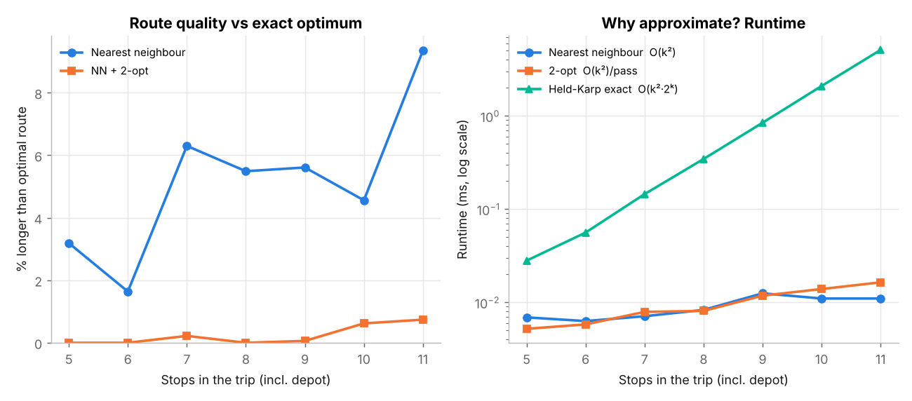{width=95%}

Held-Karp's runtime grows about 2.4× per extra stop. At 30 stops it would need roughly 30² × 2³⁰ ≈ 10¹² operations, which is why an approximation is required. Nearest neighbour alone can be 28 % worse than optimal; **2-opt brings it to within 0.74 % on average**. On real trip sizes, 2-opt shortens routes by 0–25 %:

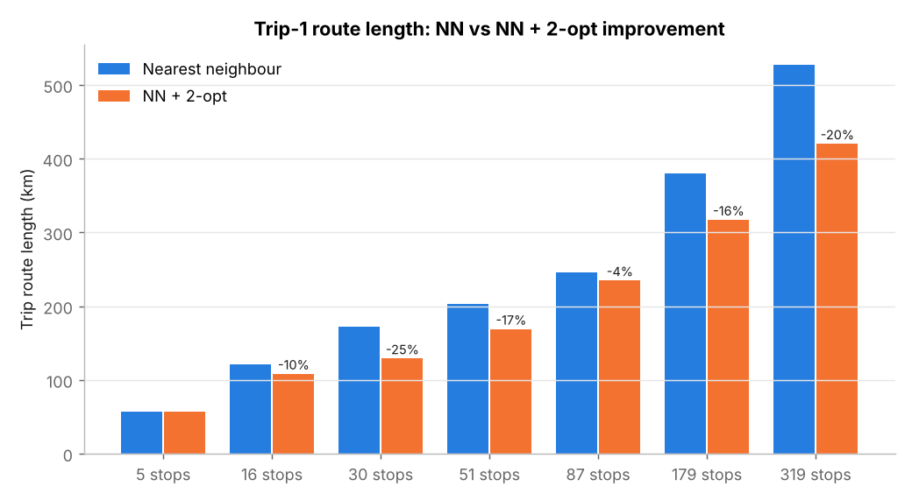{width=75%}

## 5.5 Shortest-path strategy

| Nodes | Dijkstra from trip stops (used) | Dijkstra from every node | Floyd-Warshall |
|---|---|---|---|
| 100 | 0.69 ms | 3.4 ms | 8.1 ms |
| 300 | **12.5 ms** | 61.7 ms | 185 ms |

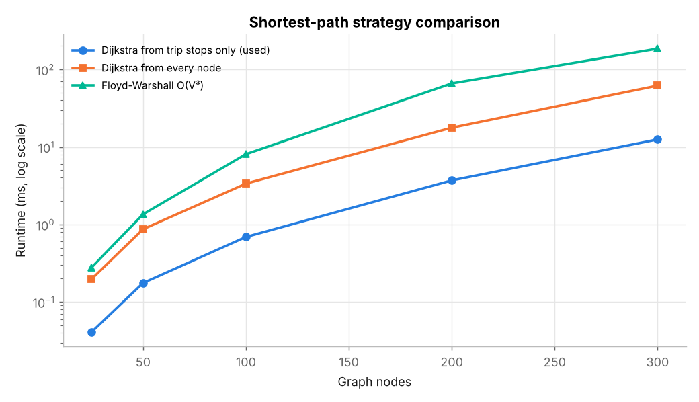{width=72%}

Running Dijkstra only from the k stops (k ≈ V/5 here) is 5× cheaper than all-pairs Dijkstra and 15× cheaper than Floyd-Warshall at 300 nodes.

## 5.6 Optimisation implemented: deadline-aware routing

**Problem found during testing.** The distance-optimal route ignores deadlines, so on bigger datasets many parcels arrive late (for example, 9 of 30 on trip 1 of `medium_city`). Two fixes were implemented and measured (`--deadline-aware`, `--banded`):

1. **Deadline bands** (experiment): visit all 1-hour stops first, then the 2-hour stops, and so on, with NN + 2-opt inside each band. **This made things worse**: routes were 2–3× longer and late parcels went *up*, because zig-zagging across the city between bands wastes the time it was meant to save. It is kept in the code as a documented negative result.
2. **Lateness repair** (adopted): start from the 2-opt tour and repeatedly move a stop to a different position whenever that lowers *(late parcels, total hours late, km)*, compared in that order. Because a move is accepted only if it improves this cost, the result can never have more late parcels than the starting tour (unit test `test_lateness_repair_never_worse`).

Results, averaged over 5 seeds, trip 1:

| Parcels | Late: 2-opt → **repair** → banded | km: 2-opt → **repair** → banded | Repair time |
|---|---|---|---|
| 50 | 5.4 → **3.0** (−44 %) → 10.0 | 90 → 125 → 189 | 2.8 ms |
| 60 | 8.0 → **5.2** (−35 %) → 15.8 | 117 → 180 → 244 | 7.4 ms |
| 100 | 16.8 → **13.0** (−23 %) → 28.6 | 137 → 179 → 323 | 15 ms |
| 200 | 43.4 → **35.0** (−19 %) → 60.6 | 179 → 204 → 485 | 143 ms |
| 400 | 89.2 → **84.0** (−6 %) → 111.8 | 243 → 319 → 779 | 815 ms |

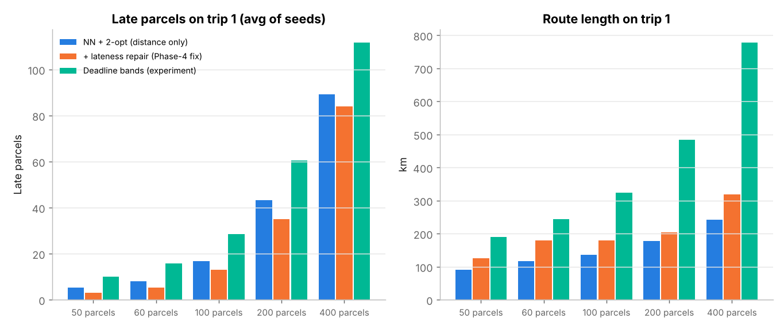{width=95%}

**Interpretation.** Lateness repair trades extra kilometres for fewer late parcels, so it is the right mode when service level matters more than fuel. Its benefit shrinks on large trips because one van with 90+ stops simply cannot reach everyone within 8 hours. At that point lateness is a *fleet-size* problem, not a routing problem (see §5.7).

## 5.7 Suggested future improvements

| Bottleneck / limitation | Suggested improvement | Expected effect |
|---|---|---|
| Knapsack O(n·W); grows if weights are in grams | Scale weights to coarser units, use branch-and-bound, or an FPTAS (value scaling) | bounded runtime for large W |
| Knapsack value ignores whether a deadline is reachable | Give a parcel value 0 if `dist(depot, dest)/speed > deadline`, or add a time dimension | fewer impossible loads |
| Dijkstra recomputed for every trip | Cache the distance rows of the depot and every customer once per day (rows are reused across trips); run sources in parallel with `multiprocessing` | ~2–4× fewer Dijkstra calls on multi-trip days |
| Single-pair queries on huge maps | A* with a straight-line-distance heuristic, or contraction hierarchies | 10–100× faster queries on city-scale maps |
| 2-opt O(k²) per pass | Neighbour lists + don't-look bits; Or-opt; NumPy vectorised delta computation | near-linear passes for k > 300 |
| Lateness repair O(k³) per pass | Incremental ETA evaluation (only the suffix after a move changes) | O(k²) per pass |
| One van; late parcels on large days | Multi-vehicle VRP with time windows (savings algorithm + local search) | most late parcels removed |
| Pure Python | Python's C-implemented `sorted` for production; Cython/Numba for DP | 3–10× faster |

# 6. Phase 5 — Demonstration evidence

All screenshots were produced from real runs by `tools/make_screenshots.py`. The full text output is in `docs/output_traces/`.

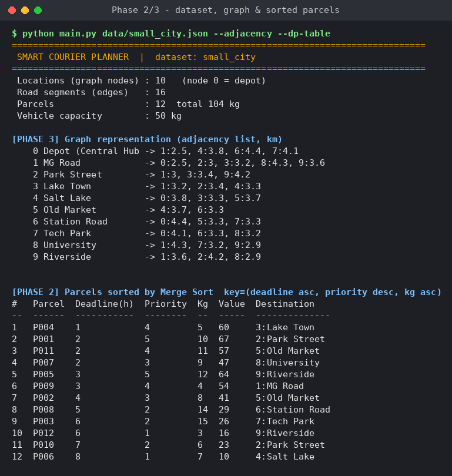{width=78%}

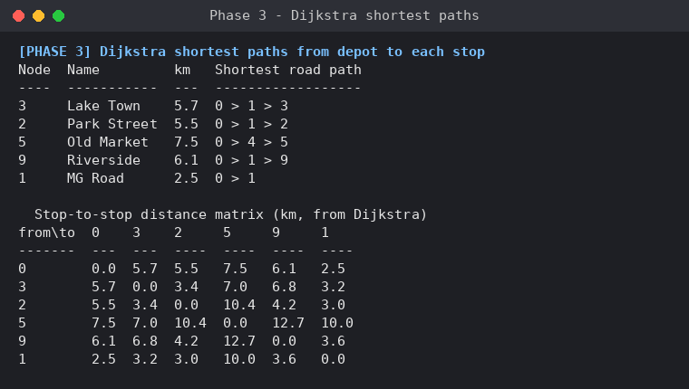{width=78%}

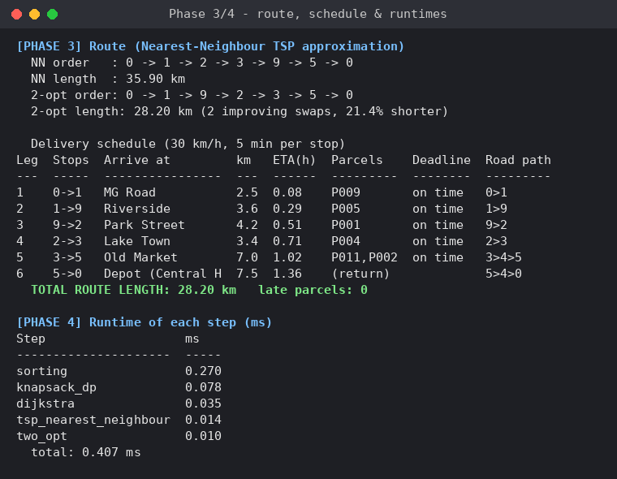{width=78%}

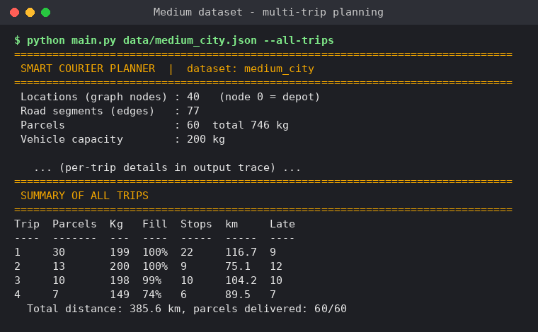{width=78%}

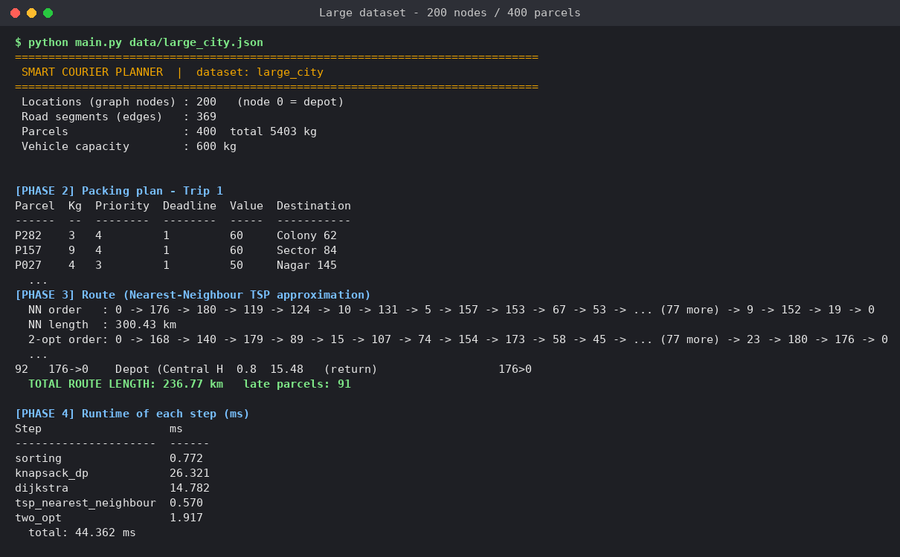{width=85%}

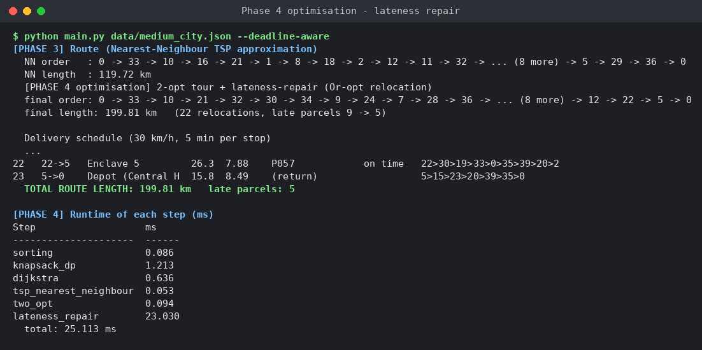{width=85%}

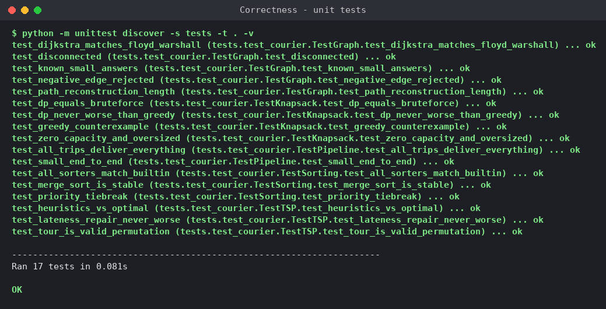{width=85%}

# 7. Testing summary

| Test | Reference it is checked against |
|---|---|
| 4 sorting algorithms, n = 0…513 | Python `sorted` |
| merge sort stability; tie-break order | hand-written expected output |
| knapsack DP (2-D and 1-D), 40 random instances | brute force over all 2ⁿ subsets |
| DP ≥ greedy (30 instances); classic greedy counter-example | known answer 220 vs 160 |
| edge cases: capacity 0, parcel heavier than van | empty selection |
| Dijkstra on 3 random graphs | Floyd-Warshall all-pairs |
| path rebuild; known small_city distances | edge-sum, hand calculation (7.5 km, 6.1 km) |
| disconnected graph; negative edge | ∞ distance; `ValueError` |
| NN / 2-opt tours are valid permutations, never shorter than optimal | Held-Karp exact optimum |
| lateness repair never worse | schedule cost comparison |
| end-to-end small_city (value 343, 28.2 km, 0 late) | hand-verified values |
| all-trips delivers each parcel exactly once, within capacity | parcel-id set equality |

Result: **17 tests, all passing** in under 0.1 s.

# 8. Conclusions and originality

* The four algorithm families combine into one pipeline: **sorting** fixes the dispatch order, **DP** fixes the load, **Dijkstra** turns the road map into a stop-to-stop distance matrix, and the **TSP approximation** orders the stops.
* Every component is exact where that is tractable (sorting, knapsack, shortest paths) and approximate where the problem is NP-hard (TSP). The approximation's error was measured rather than assumed: NN + 2-opt averaged 0.74 % above optimal.
* The performance study identified the real bottlenecks (knapsack and Dijkstra), justified each design choice with measurements, and led to one implemented optimisation (lateness repair) and one documented failed attempt (deadline bands).
* All algorithms (merge, quick, heap and insertion sort; knapsack DP with traceback; Dijkstra; Floyd-Warshall; nearest neighbour; 2-opt; Or-opt lateness repair; Held-Karp) are implemented from scratch in this repository. They use no routing or optimisation libraries; `heapq` is the only data-structure helper.
